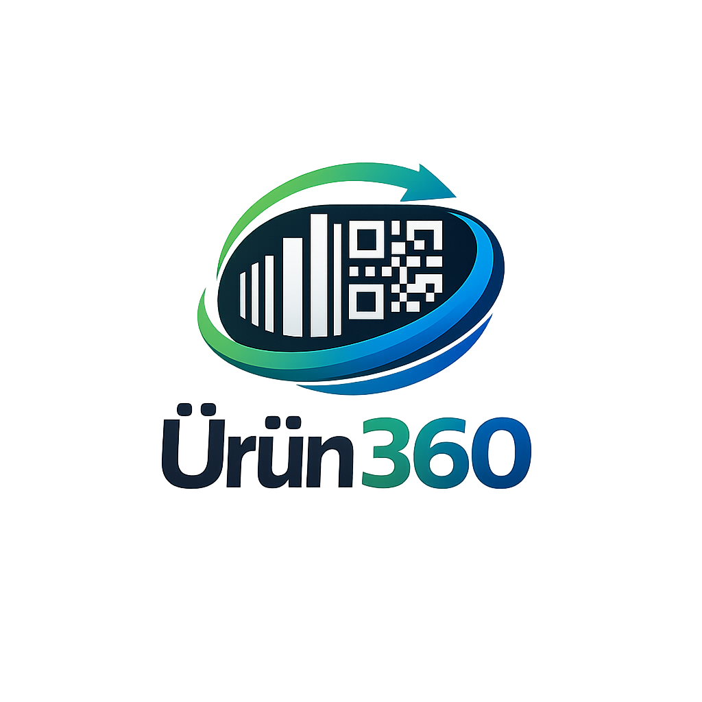
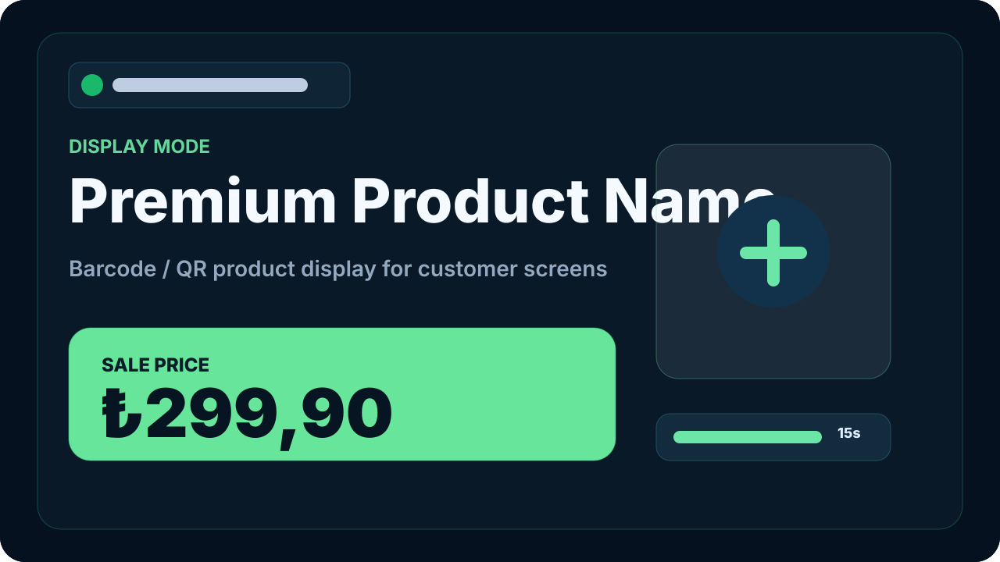
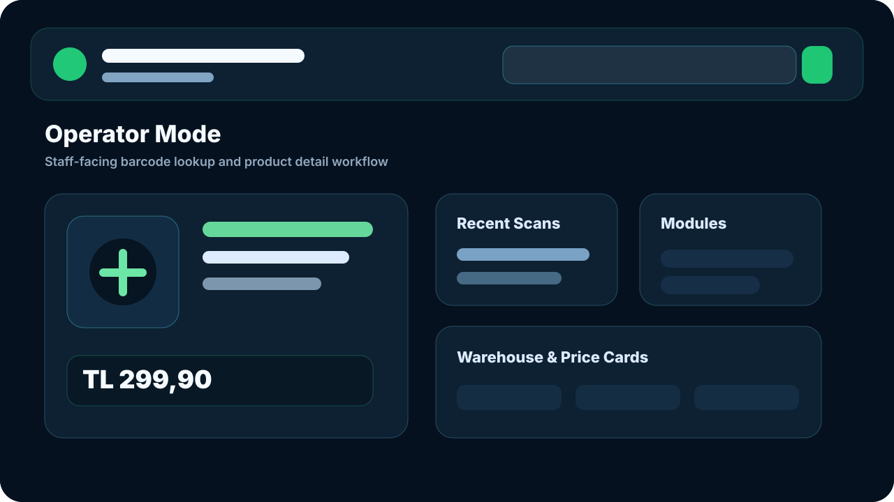
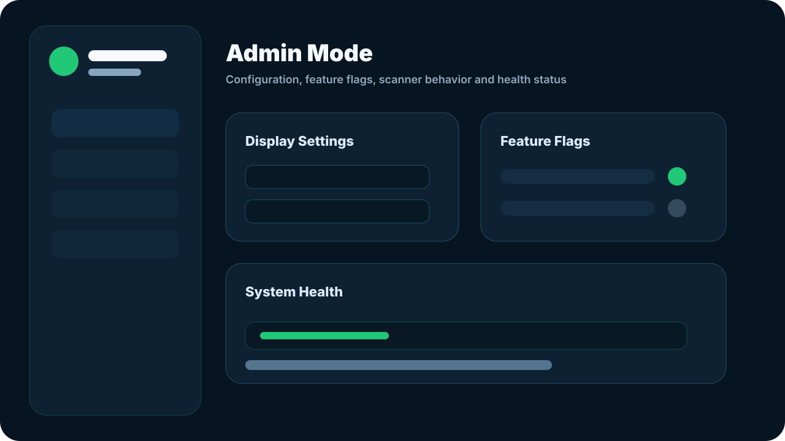

<p align="center">
  
</p>

<h1 align="center">Ürün360</h1>

<p align="center">
  Wolvox ERP Integrated Barcode & QR Product Display Platform
</p>

<p align="center">
  <strong>Scan a product. See the product instantly.</strong>
</p>

> This repository is a public project showcase. Source code is private.

## Overview

Ürün360 is a modern product display and barcode/QR lookup platform designed for retail, warehouse, and service environments.

The application allows staff or customers to scan a barcode/QR code and instantly view product information on a responsive screen such as a cashier monitor, tablet, customer display, or TV.

## Purpose

Ürün360 was designed to provide a clear, fast, browser-based product information experience for environments where barcode readers, customer-facing displays, and internal ERP data need to work together.

The goal is to keep the user experience simple:

- Scan a product.
- Retrieve product information securely through the backend.
- Display the product name, price, stock, image, and metadata clearly.
- Return automatically to an idle screen after a configurable timeout.

## Core Use Case

1. A cashier or staff member scans a barcode or QR code.
2. The application captures the scanned value through a standard barcode reader.
3. The backend queries product information from the Wolvox Firebird database.
4. Product details are displayed on a modern responsive screen.
5. The screen automatically returns to idle mode after a configurable timeout.

## Key Features

- Barcode / QR based product lookup
- Responsive display for monitor, tablet, phone, and TV screens
- Display mode for customer-facing screens
- Operator mode for staff usage
- Admin mode for configuration
- Product details screen
- Multi-price display
- Warehouse-based stock balance display
- Product image support
- Product group / subgroup information
- Voice price reading support
- Configurable display timeout
- Windows Service based deployment
- Local/server-first architecture

## Application Modes

### Display Mode

Route: `/display`

Customer-facing or kiosk-style screen.
Used for waiting for barcode/QR input, showing product name and price clearly, displaying product details for a limited time, and returning to idle screen automatically.



### Operator Mode

Route: `/operator`

Staff-facing screen.
Used for manual product search, barcode/QR lookup, viewing detailed product information, and accessing operational modules.



### Admin Mode

Route: `/admin`

Configuration and management screen.
Used for display timeout settings, scanner behavior settings, feature visibility, application configuration, and health/status checks.



## Preview

The showcase visuals in this repository are representative mockups. They do not contain customer data, real product data, database details, or source code.

## Technology Stack

### Frontend

- React
- TypeScript
- Vite
- Tailwind CSS
- shadcn/ui
- TanStack Query
- React Hook Form
- Zod

### Backend

- C#
- .NET / ASP.NET Core Web API
- Swagger / OpenAPI
- Serilog
- xUnit

### Database

- Firebird
- Wolvox ERP database integration
- Read-only data access principle for initial phases

### Testing & Quality

- Playwright
- ESLint
- Prettier
- Snyk-ready dependency review
- Code review ready structure

### Deployment

- Windows Service
- Local/server installation
- Browser-based access
- Single-port application hosting

## Architecture

```text
Barcode Reader / QR Reader
        ↓
React Display Interface
        ↓
ASP.NET Core Web API
        ↓
Wolvox Firebird Database
        ↓
Product information displayed on screen
```

## Deployment Model

Ürün360 is not distributed as a traditional desktop application.

The application runs on a local machine or internal server as a Windows Service. Users access it through a browser.

Example URLs:

```text
http://localhost:8890/display
http://SERVER-IP:8890/display
http://SERVER-IP:8890/operator
http://SERVER-IP:8890/admin
```

## Security Notes

- The frontend never connects directly to the database.
- Database connection information is kept on the backend side.
- Firebird access is handled through the API layer.
- The initial integration is designed with a read-only principle.
- Risky operations such as price update, image upload, and label printing require additional validation and authorization before activation.

## Roadmap

- [x] Product concept and architecture
- [x] Display / Operator / Admin mode planning
- [x] React frontend prototype
- [x] ASP.NET Core API structure
- [x] Barcode reader workflow
- [x] Windows Service deployment planning
- [ ] Firebird read-only production integration
- [ ] Advanced role-based authorization
- [ ] Label printing workflow
- [ ] Product image management
- [ ] Extended reporting and analytics

## Project Status

This project is currently under active development.
Source code is private and not included in this repository.

## Disclaimer

Ürün360 is an independent custom software project designed for Wolvox ERP integrated product lookup scenarios.
This repository is for portfolio and documentation purposes only.
